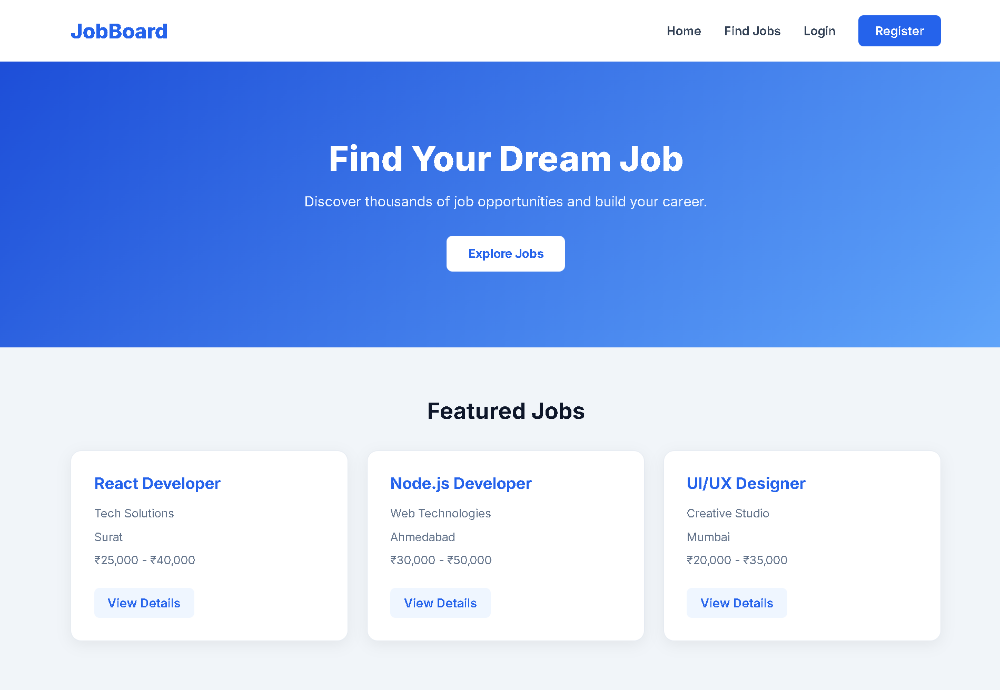
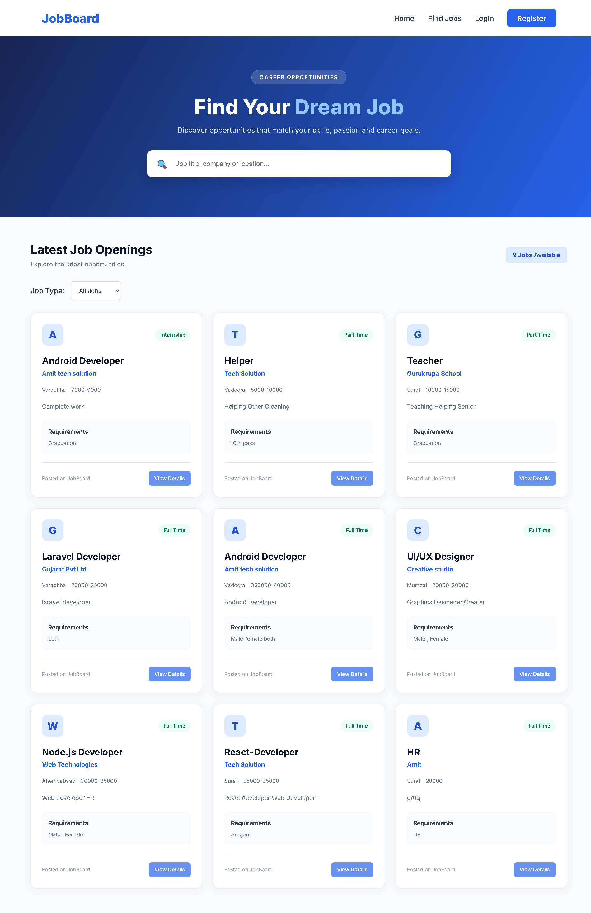
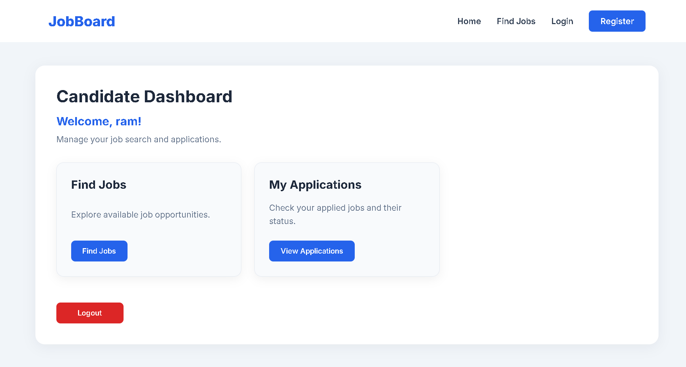
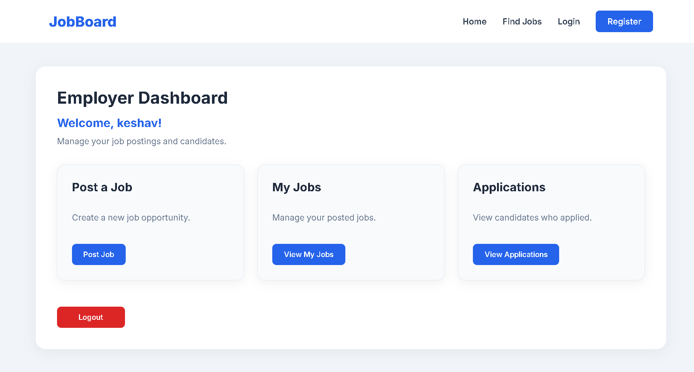

# JobBoard - MERN Stack Job Portal

A full-stack Job Portal developed using MongoDB, Express.js, React.js and Node.js.

## Project Overview

JobBoard is a web application that connects employers and job seekers. Employers can post job openings and manage applications, while candidates can search and apply for jobs.

## Features

- Candidate and Employer Registration/Login
- JWT Based Authentication
- Employer Dashboard
- Candidate Dashboard
- Post and Manage Jobs
- Search and Filter Jobs
- Job Details Page
- Apply for Jobs
- Resume Upload (PDF)
- View Job Applications
- Accept / Reject Applications
- Application Status Tracking

## Technologies Used

### Frontend
- React.js
- HTML
- CSS
- JavaScript
- Axios
- React Router DOM

### Backend
- Node.js
- Express.js
- MongoDB
- Mongoose
- JWT
- Bcrypt.js
- Multer

## Project Structure

JobBoard/
├── client/
├── server/
└── README.md

## Installation and Setup

### 1. Clone Repository

```bash
git clone https://github.com/yadavamit4git/JobBoard.git
```

### 2. Open Project

```bash
cd JobBoard
```

### 3. Install Backend Dependencies

```bash
cd server
npm install
```

### 4. Configure Environment Variables

Create a `.env` file inside the server folder.

Add:

```env
PORT=8000
MONGO_URI=mongodb://127.0.0.1:27017/JobBoardDB
JWT_SECRET=your_own_secret_key
```

Use your own secure JWT secret.

### 5. Start Backend

```bash
npm run dev
```

### 6. Install Frontend Dependencies

Open another terminal:

```bash
cd client
npm install
```

### 7. Start Frontend

```bash
npm run dev
```

Open the local URL shown in the terminal.

## Database

MongoDB is used to store:
- Users
- Jobs
- Applications

## Author

Amit Yadav

GitHub: https://github.com/yadavamit4git

## 📸 Project Screenshots

### 1. Home Page


### 2. Find Jobs Page


### 3. Candidate Dashboard


### 4. Employer Dashboard

# JobBoard - MERN Stack Job Portal

JobBoard is a web-based job portal developed using the MERN Stack. It connects employers and candidates through a simple and user-friendly platform.

Employers can post and manage job opportunities, while candidates can search for jobs and apply by uploading their resumes.

## 🚀 Features

### 👤 Candidate
- Candidate Registration and Login
- Browse Available Jobs
- Search Jobs by Title, Company, and Location
- View Job Details
- Apply for Jobs
- Upload Resume in PDF Format
- View Applied Jobs
- Track Application Status

### 🏢 Employer
- Employer Registration and Login
- Employer Dashboard
- Post New Jobs
- View and Manage Posted Jobs
- View Candidate Applications
- View Candidate Details
- Accept or Reject Applications

### 🔐 Authentication
- User Registration and Login
- Password Hashing using bcrypt
- JWT-based Authentication
- Role-based Access Control

## 🛠️ Technologies Used

**Frontend**
- React.js
- HTML
- CSS
- JavaScript
- Axios
- React Router DOM

**Backend**
- Node.js
- Express.js

**Database**
- MongoDB
- Mongoose

**Other Tools**
- Visual Studio Code
- Git
- GitHub
- Multer

## 📸 Project Screenshots

### 1. Home Page


### 2. Find Jobs Page


### 3. Candidate Dashboard


### 4. Employer Dashboard


## 📂 Project Structure

```text
JobBoard/
│
├── client/
│   ├── public/
│   ├── src/
│   └── package.json
│
├── server/
│   ├── config/
│   ├── controllers/
│   ├── middleware/
│   ├── models/
│   ├── routes/
│   ├── uploads/
│   ├── .env
│   ├── index.js
│   └── package.json
│
├── screenshots/
│   └── screenshots/
│       ├── home.png
│       ├── find-job.png
│       ├── candidate-dashboard.png
│       └── employer-dashboard.png
│
├── .gitignore
└── README.md
```

## ⚙️ Installation and Setup

### 1. Clone Repository

```bash
git clone https://github.com/yadavamit4git/JobBoard.git
```

### 2. Open Project Folder

```bash
cd JobBoard
```

### 3. Install Backend Dependencies

```bash
cd server
npm install
```

### 4. Configure Environment Variables

Create a `.env` file inside the server folder.

```env
PORT=8000
MONGO_URI=mongodb://127.0.0.1:27017/JobBoardDB
JWT_SECRET=your_secret_key
```

### 5. Start Backend Server

```bash
npm run dev
```

### 6. Install Frontend Dependencies

Open a new terminal:

```bash
cd JobBoard/client
npm install
```

### 7. Start Frontend

```bash
npm run dev
```

Open the application in your browser:

```text
http://localhost:5173
```

## 🗄️ Database

- Database: MongoDB
- Database Name: JobBoardDB
- ODM: Mongoose

Make sure MongoDB is running before starting the backend server.

## 👨‍💻 Author

**Amit Yadav**

GitHub: https://github.com/yadavamit4git

## 📄 License

This project is created for educational and learning purposes.